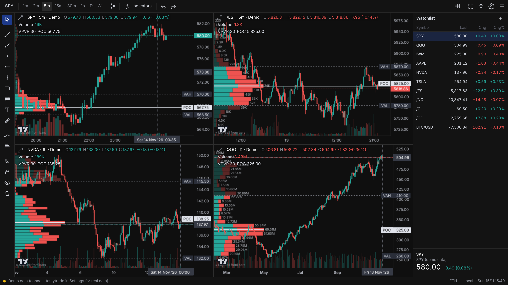
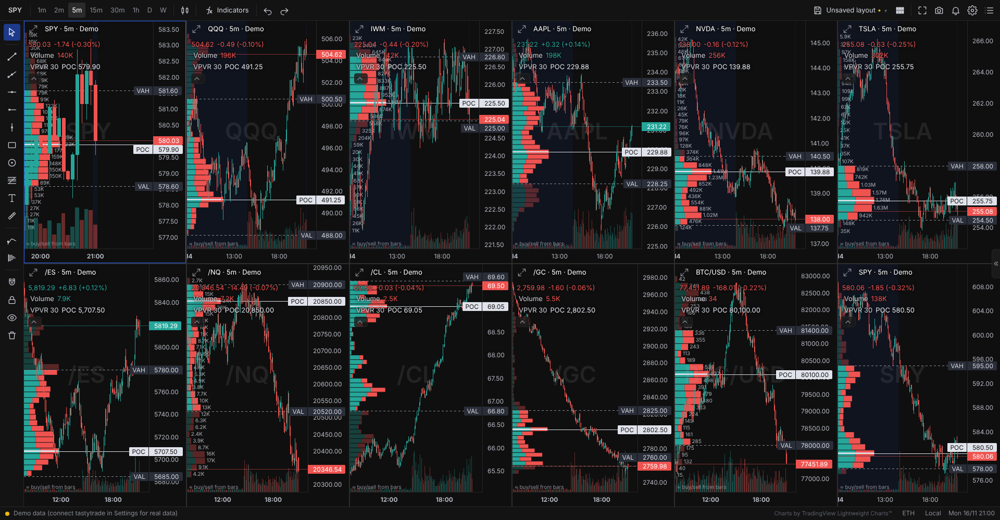

# Desktop Charts

A TradingView-style charting app that runs on your own computer. Dark theme, timeframe bar,
up to 24 charts per window, drawing toolbar, watchlists with extended-hours change, price alerts,
saved layouts, indicator search, volume profile / TPO with POC, VAH and VAL,
and anchored VWAP. Charts are drawn with TradingView's open-source
[Lightweight Charts](https://github.com/tradingview/lightweight-charts) library (Apache 2.0).

Market data comes from tastytrade (DXLink streaming). The app is **read-only charting**:
it never touches accounts, positions or orders. Without credentials it runs on generated demo data.

12-chart layout

## Run it

1. Install **Node.js 18 or newer** (LTS from https://nodejs.org). There are no npm packages to install.
2. Get the code: `git clone https://github.com/trader-larry/desktop-charts.git` (or use **Code → Download ZIP** on GitHub and unzip it anywhere).
3. Start it:
   - Windows: double-click `start-windows.bat`
   - Mac: double-click `start-mac.command` (first time: right-click → Open)
   - Or in a terminal inside the folder: `node server.js`
4. The charts open at **http://localhost:8787** in their own Chrome or Edge app window (no tabs or address bar), which remembers its size and position. If neither browser is installed, your default browser opens instead. To always use a normal tab, set `APPWINDOW=0` near the top of the start script. Leave the black server window open while you chart.

Optional: install the charts as an app (open http://localhost:8787 in a normal Chrome or Edge tab, then browser menu → Install). You get a Start-menu shortcut and dark title bars, and `start-windows.bat` then opens the installed app instead of a separate window.

Each chart also remembers its zoom and scroll for every timeframe, so it reopens showing the same span. The fit button (Alt+R) puts a chart back to the default view.

The server only listens on your own machine (127.0.0.1), so nothing is exposed to your network.

## Connect tastytrade

tastytrade's API uses OAuth. You need a **client secret** and a **refresh token** from a personal OAuth app:

1. On tastytrade.com: My Profile → API → OAuth Applications. Create an application if you don't have one,
   tick the `read` scope, and save the **client secret**.
2. In that application choose Manage → Create Grant. Copy the **refresh token**.
3. In the chart app click the gear icon (top right), paste both, and press **Save and connect**.

The two values are written to `config.json` in this folder (you can also copy `config.example.json`
to `config.json` and fill it in by hand). The file is listed in `.gitignore`, so it stays out of git;
never commit it or paste its contents anywhere public. The browser never receives
the secret; the local server swaps it for short-lived tokens itself. The status bar at the bottom
turns green and says "Live" when data is streaming (hover it for details).

Symbols: stocks/ETFs as usual (`AAPL`, `SPY`), futures with a slash for the front month (`/ES`, `/NQ`,
`/CL`, `/GC`) or a specific contract (`/ESZ6`), crypto as `BTC/USD`.

## Using it

| | |
|---|---|
| Change symbol | Click the symbol at top left, or just start typing on the chart |
| Timeframes | 1m 2m 5m 15m 30m 1h D W in the top bar |
| Multi-chart layouts | Layout button (grid icon, top right): 1, 2, 3, 4, 6, 8, 12 (6 × 2) or 24 (12 × 2) charts. Each chart has its own symbol, timeframe, chart type and indicators. Click a chart to make it active (blue outline); the top bar, drawing tools and watchlist act on the active chart. Click a chart's title to change its symbol. Tab / Shift+Tab cycles charts, Alt+Enter (or the arrows icon in a chart's legend) maximizes one chart and restores the layout |
| Sync in layout | In the layout menu: Symbol, Interval, Crosshair (on by default) and Date range. Drawings stay on the chart they were drawn on; horizontal lines and rays show on every chart of that symbol. Select a drawing and use the "This chart / All charts" button to switch |
| Indicators | **Indicators** button or `/`. Star the ones you use for the Favorites list. Hover a legend row to hide, edit or remove it |
| Volume profile | *Volume Profile, Visible Range* (on by default), *Session Volume Profile*, *Fixed Range* (range tool in the left toolbar) |
| TPO | *TPO (Market Profile)*: letters per 30-minute period (blocks when zoomed out), POC, value area, initial balance |
| SPX levels | *SPX Levels (XSP)* in Indicators: type the day's posted SPX levels (call/put trigger and stop, UT1–3, DT1–3) into its settings; 0 hides a level. On an XSP chart they are divided by 10 automatically, on SPX they draw as posted (or pick XSP / SPX yourself). Lines cover the latest session only. Use Defaults → Apply to all charts to update every chart at once |
| Anchored VWAP | Anchor tool in the left toolbar, then click a bar. Bands and anchor time are in its settings |
| Drawing toolbar | Left side of the window. When the window is too short to show every tool, small up and down arrows appear at the ends; click them to scroll the tools |
| Drawings | Trend line, ray, horizontal line/ray, vertical line, rectangle, circle, fib retracement, text, measure. Click a drawing to select, drag to move, Delete to remove. Magnet snaps to OHLC |
| Saved layouts | Layout name button at the top right: Save layout (Ctrl+S), Save as new layout, Rename, and a list of saved layouts to switch between (hover one for the delete ×). A dot after the name means unsaved changes. Layouts are stored in this browser |
| Price alerts | Right-click a chart → Add alert, press Alt+A (price at the cursor), click Add alert on a horizontal line's toolbar, or use the bell button → + Create. Conditions: crossing, crossing up, crossing down; once or every time. Alerts show as orange lines you can drag. When one fires: chime, pop-up, Windows/Mac notification and an entry in the bell's Log. Alerts are checked while the app is open |
| Extra windows | Layout button (grid icon) → Windows → + New window opens another window with its own charts, layout and choice of watchlist (pick it from the watchlist name). Watchlists, drawings, alerts and saved layouts are shared between windows. Extra windows reopen with the main window at the same size and position (allow pop-ups for localhost once). Rename or delete them from the same menu |
| Hide the watchlist | » in the watchlist header or the list button at the top right hides it to give the charts more room; the list button or the tab at the right edge brings it back. Remembered per window |
| Multiple watchlists | Click the watchlist's name: create a new list, make a copy, rename, switch between lists, or delete one (× on hover) |
| Watchlist options | ⋮ button on the watchlist: choose columns: Last, Change, Change %, Volume and Ext (pre-market / after-hours change % for stocks; hover for the price) |
| Undo / redo | Ctrl+Z / Ctrl+Y (drawings) |
| Reset view | Alt+R or the corners icon |
| Save image | Camera icon |
| RTH / ETH | Status bar button (stocks): regular hours only, or include extended hours . Pre-market and after-hours bars are shaded on intraday stock charts (turn off in Settings) |
| Background and padding | Settings → Display: chart background colour, and chart padding (top and bottom space in %, right space in bars). Default buttons put them back |
| Watermark / description | Settings → Display: large faint ticker with the company name below it, behind each chart (on by default) |
| Time zone | Status bar button or Settings |

Drawings, anchored VWAPs and fixed-range profiles are saved per symbol; the chart layout, each chart's
symbol, timeframe and indicators, the watchlist and settings are saved in your browser for next time.

**Buy/sell split in volume profiles is an estimate** from each bar's shape (where it closed within its range),
not true bid/ask order flow, which isn't available from candle data. The chart labels it "≈ buy/sell from bars".

## Files

- `server.js` — tiny local web server + tastytrade REST (OAuth token, quote token, symbol lookup)
- `public/js/datafeed.js` — DXLink websocket client (candles, quotes) and the demo feed
- `public/js/indicators.js` — indicator math and registry (add new ones here)
- `public/js/profile.js` — volume profile / TPO math and drawing
- `public/js/drawings.js` — drawing tools
- `public/vendor/lightweight-charts.mjs` — Lightweight Charts 5.2.1 (Apache 2.0, see LICENSE file next to it)

## License

The app's own code is MIT licensed (see `LICENSE`). Charts are rendered with
[TradingView Lightweight Charts™](https://www.tradingview.com/lightweight-charts/), Copyright TradingView, Inc.,
bundled unmodified under the Apache License 2.0 (see `NOTICE` and `public/vendor/LICENSE-lightweight-charts.txt`).

This project is not affiliated with TradingView or tastytrade. It is a charting tool, not financial advice.
